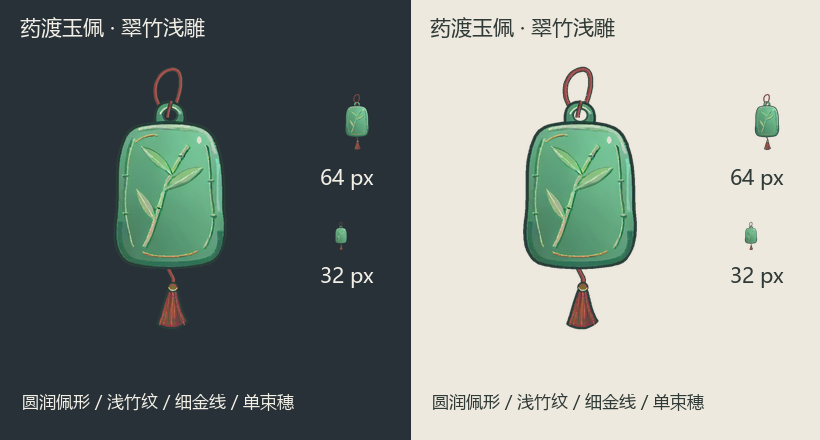

# 药渡玉佩第二版：翠竹浅雕

2026-11-19。用户确认玉佩参考方向后完成重绘，采用翠竹佩形、局部浅雕和细金导药纹。已替换 `1.6/Textures/Things/Item/MoeLotl/MX_MedicinePendant.png`，512×512 RGBA，保留原Def引用。此轮范围为药渡玉佩；十一种丹药的乳白丹体与传统纹样仍待下一轮制作。



## 变化与制作

- 去掉首版宽金盖、中央方形凹框与C形线条，改成圆肩扁厚佩体、一体穿绳耳、竹节状边缘、斜竹和三片浅雕叶。
- 绿色玉面保留留白与宽高光；细金线沿边角和一段竹茎分布，单束短穗通过自然弯曲绳连接。内部刻纹比外轮廓细。
- 新底稿由 `tools/pendant_art.py` 的原创贝塞尔曲线和色面绘制；馆藏照片只用于观察结构，没有输入模型、描摹轮廓或复制像素。SDXL细化表面后，用原创底稿的透明遮罩恢复外缘、穿绳孔及细绳，缩放到512px。
- 本次使用本机ComfyUI 0.46.0、SDXL Base 1.0；这是原创底稿约束的AI辅助贴图。模型仍遵循CreativeML Open RAIL++-M，权重不随模组分发。

## 生成与复现

采用B版：1024×1024图生图，seed `2026111952`，30 steps，CFG 5.5，DPM++ 2M / Karras，denoise 0.28。先前A版seed `2026111951`、denoise 0.42，出现较碎的玉边与金线，未采用。[两版对比](art/pendant-v2-comparison.png)保留差异。

模型输入以绿色扁厚石佩、圆肩、竹枝叶、浅雕、细金线、红绳短穗等可见形态描述，不使用药渡、萌螈、煞气等专有名词。完整正负提示词、节点参数见 [API工作流](art/pendant-v2-api.json)，可编辑节点图见 [GUI工作流](art/pendant-v2-workflow.json)。原图和最终图哈希见 [生成记录](art/generation.json)。

```powershell
python tools/generate-item-art.py --comfy '<本机ComfyUI目录>' --start 11 --limit 1 --seed 2026111941 --denoise 0.28 --output artifacts/art-style/pendant-v2/b
python tools/review-item-art.py --source artifacts/art-style/pendant-v2/b --only MX_MedicinePendant
# 查看预览后再执行发布：
python tools/review-item-art.py --source artifacts/art-style/pendant-v2/b --only MX_MedicinePendant --publish
```

基础种子加任务索引11，得到实际种子2026111952。生成器同时写入通用GUI工作流；本次验收后的排版副本在ComfyUI的Workflows中名为 `2026-11-19_moelotl_pendant_v2.json`，可通过本机 `http://127.0.0.1:8188` 打开。新机器复现需要先生成输入底稿；不能仅导入工作流就假定其输入图片已经存在。更换软硬件不保证逐像素一致。

## 验收

| 项目 | 结果 |
| --- | --- |
| A版视觉检查 | MINOR，边缘和金线有碎裂感；弃用，降低重绘强度后生成B版 |
| B版视觉检查 | PASS，圆肩、竹叶、绳孔、绳穗连接完整，深浅背景无明显洋红外缘；正面浅雕与玉面明暗一致 |
| 缩略图 | 128／64px可辨斜竹、叶片和单束穗；32px细金线及竹节弱化，只要求佩体和红穗可辨 |
| 文件和接入 | 512×512 RGBA、四边透明、边距充足；沿用Graphic_Single纹理引用；其余11药PNG哈希不变 |
| 生成溯源 | ComfyUI报告success；原始图哈希与清单一致，保存底稿来源、最终PNG哈希、API与GUI工作流；GUI坐标检查8节点无重叠 |
| 项目检查 | 编译、11药7丹剂静态检查通过；三个美术脚本语法检查及发布流程通过；差异空白和文档链接检查通过 |
| 游戏显示 | 尚未进行本次贴图的实际游戏内截图验收；上述文件与缩略图检查不替代游戏实测 |

`review-item-art.py --only` 支持选择性更新和预览，以当前发行贴图展示未选中的物品；发布前核对本次清单，避免单件重绘覆盖其他物品。不会因为更新玉佩而重算或覆盖十一药纹理。
